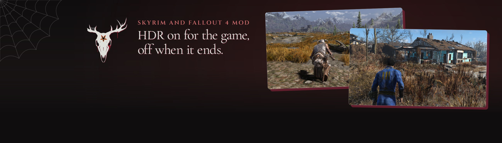
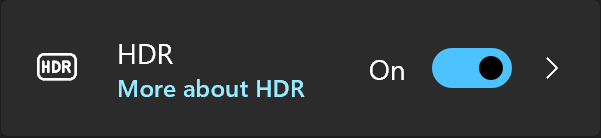

<p align="center">

</p>

Turns Windows HDR on when Skyrim or Fallout 4 starts and back off when it ends, so you never flip it by hand again.

<p align="center"><picture>
  <source media="(prefers-color-scheme: dark)" srcset="docs/divider.png">
  
</picture></p>

## How it works

- **On before the game opens.** It runs as the game loads, ahead of the game's window, so the game and any HDR mod find HDR already on.
- **Off however the game ends.** A normal quit, qqq, a crash, End Task: a small helper waits for the game to go, then turns HDR off.
- **Only when it was off.** If you already keep HDR on, it leaves it on, during the game and after.
- **Your main monitor only.** Other monitors stay as they are.

<p align="center"></p>

## Install

Download the file for your game from Nexus Mods and install it with your mod manager, or copy its folder into the game's Data folder. Start the game through the script extender as usual.

Requires the Skyrim Script Extender (SKSE) or Fallout 4 Script Extender (F4SE). No Address Library and no Visual C++ redistributable needed. It reads no game memory, so it has no game version to match.

Tested on Skyrim SE 1.5.97 and AE 1.6.640, 1.6.1170 and 1.7.104, and Fallout 4 OG 1.10.163 and AE 1.11.240.

## Choose what it does

Nothing to set up. To turn the mod off without removing it, add a file called `HdrSwitch.ini` beside the DLL:

```ini
[General]
bEnabled=0
```

## Good to know

- **It switches HDR, nothing more.** Neither game has HDR of its own, so how the picture looks is down to your HDR mod and your monitor.
- **Your monitor has to offer HDR.** If it doesn't, the mod does nothing. Tested on Windows 11.
- **Two games at once.** If another game with this mod is also open, the first to close turns HDR off for both.
- **When nothing can turn it off.** If you end the helper by hand (rundll32 in Task Manager), or the PC loses power or restarts, HDR stays on until you turn it off in Windows.
- **Your mod manager may wait a moment.** The helper outlives the game by about a second, so a manager can show the game as running for that long.
- **A log if you need it.** `HdrSwitch.log` in the script extender's folder under `Documents\My Games` says what it did on the last launch.

<details><summary>Build it yourself</summary>

You need Visual Studio's C++ build tools, xmake and Python.

```
python tools/build.py
```

It writes the DLL and the zips to `dist`. Set `HDR_SWITCH_OFF` in the environment to keep the plugin quiet in test runs; it also stays quiet when the game runs on a hidden desktop.

</details>

## Report a problem

Open an issue here, or post in Bugs on the Nexus page, with your game version and the log. Or find me on [Discord](https://discord.com/invite/sayngwyn).

## More by sayngwyn

[](https://www.nexusmods.com/profile/sayngwyn/mods)

Also on [my website](https://sayngwyn.com/projects).

## Credits

- **SKSE and F4SE teams** for the script extenders it loads through.

---

Made with AI. Claude contributed heavily under my direction: I decided what it does and checked it, and the AI wrote most of the code, its tests and these docs.

## Licence

MIT. See [LICENSE](LICENSE). The sayngwyn skull mark and page art aren't covered by it.
